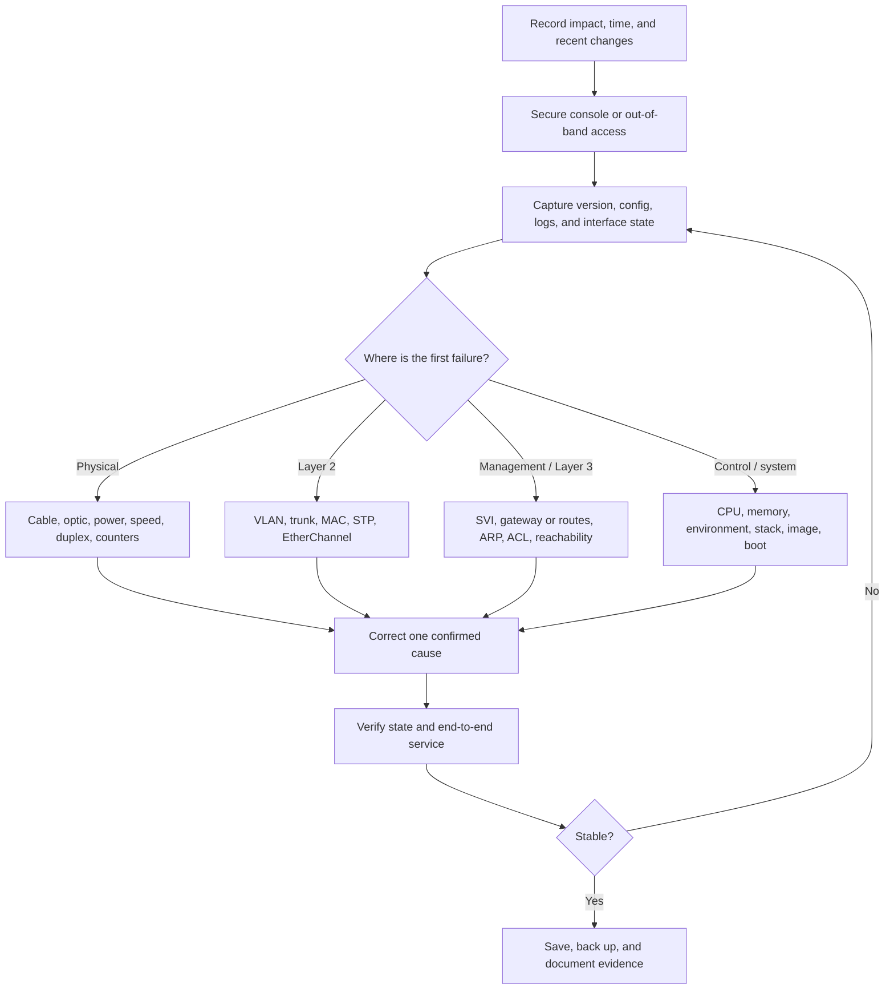
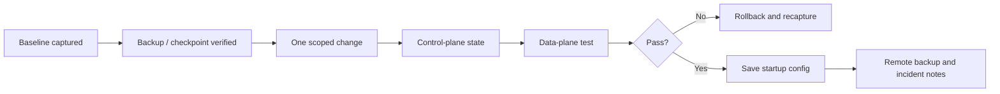

# 05 - Cisco Switch Diagnostics, Troubleshooting, Recovery, and Configuration

> [!abstract]
> A reusable Cisco IOS and IOS XE switch runbook: preserve evidence, identify the failing layer, repair only the confirmed cause, validate service, and retain a recovery path.

> [!warning] Production safety
> Command availability and recovery steps vary by switch family, software image, licensing, stack mode, and boot loader. Capture the exact model and version with `show version`, consult that platform's Cisco guide before a boot-loader or password-recovery operation, and arrange console access plus a maintenance window before any disruptive action.

> [!info] Packet Tracer Support: Partial
> Packet Tracer supports many core `show`, VLAN, trunk, STP, EtherChannel, interface, and save commands. It does not accurately reproduce every hardware counter, crash, boot-loader, image, archive, stack, or password-recovery workflow.

## 1. Outcomes

Use this note to:

- collect a read-only baseline before changing the switch;
- isolate physical, Layer 2, management, control-plane, or configuration faults;
- recover an err-disabled port, a damaged configuration, lost access, or a boot problem;
- apply a safe baseline configuration with placeholders;
- prove recovery with state, counters, logs, and an end-to-end test.

## 2. Incident Flow



## 3. First Response and Evidence Preservation

1. Record the affected users, ports, VLANs, paths, start time, and last known good state.
2. Ask what changed: cabling, endpoint, VLAN, trunk allow-list, STP, port channel, security policy, software, power, or configuration.
3. Prefer console or out-of-band access. Do not remove the only working management path.
4. Capture output before clearing counters, logs, MAC addresses, ARP entries, or restarting anything.
5. Compare `---show running-config` with `show startup-config`; an unsaved good running configuration can be lost by reload, while a bad saved configuration can survive it.
6. Change one cause at a time and keep a rollback method.

### Minimum read-only capture

```cisco
terminal length 0
show clock
show version
show inventory
show running-config
show startup-config
show logging
show interfaces status
show ip interface brief
show vlan brief
show interfaces trunk
show spanning-tree summary
show etherchannel summary
show cdp neighbors detail
show lldp neighbors detail
show mac address-table
show processes cpu sorted
show memory statistics
show environment all
show boot
dir flash:
```

> [!note] Platform-dependent commands
> `show inventory`, `show environment all`, `show boot`, CPU/memory displays, stack commands, and output filters are not identical on every platform. Use `show ?` and the command reference for the exact image. An unsupported command is not evidence that the subsystem is healthy.

## 4. Important Show Commands

### Configuration, identity, and system health

| Command | Purpose | Look for |
|---|---|---|
| `show running-config` | Display the active configuration | Unexpected commands, missing VLAN/interface settings, unsaved changes |
| `show startup-config` | Display the configuration used at the next boot | Difference from the known-good running configuration |
| `show version` | Display model, software, uptime, reload reason, and configuration register where supported | Recent reload, wrong image, low uptime, unexpected license or model |
| `show inventory` | List chassis, modules, and serial information | Missing or unrecognized hardware |
| `show boot` | Display boot variables where supported | Wrong or missing image path |
| `dir flash:` | List local flash files | Image/config presence and free space |
| `show logging` | Display buffered syslog | Link flaps, STP, security, power, or crash clues with timestamps |
| `show processes cpu sorted` | Display CPU use by process | Sustained high CPU and the responsible process |
| `show memory statistics` | Display memory use | Abnormal depletion or fragmentation |
| `show environment all` | Display temperature, fans, and power where supported | Failed fan/PSU or thermal alarm |

### Interfaces and forwarding

| Command | Purpose | Look for |
|---|---|---|
| `show interfaces status` | Summarize port state, VLAN, duplex, speed, and type | `notconnect`, `disabled`, `err-disabled`, wrong VLAN, forced settings |
| `show interfaces description` | Display descriptions and link state | Wrong circuit/endpoint identity or stale description |
| `show interfaces <interface>` | Display detailed state and counters | Line protocol, errors, drops, resets, duplex, last state change |
| `show interfaces counters errors` | Summarize error counters where supported | CRC, frame, overrun, underrun, collision, or output errors |
| `show interfaces switchport` | Display administrative and operational switchport settings | Access/trunk mismatch, wrong access/native VLAN |
| `show ip interface brief` | Summarize routed interfaces and SVIs | `administratively down`, line protocol down, wrong/missing address |
| `show mac address-table` | Display learned MAC addresses | MAC absent, learned on the wrong port, or moving between ports |
| `show arp` | Display IPv4 ARP entries where supported | Missing or stale neighbor resolution |

### VLANs, trunks, STP, neighbors, and bundles

| Command | Purpose | Look for |
|---|---|---|
| `show vlan brief` | Display VLANs and access-port membership | Missing/inactive VLAN or access port in the wrong VLAN |
| `show interfaces trunk` | Display operational trunks, native VLAN, and allowed/forwarding VLANs | Link not trunking, native mismatch, required VLAN absent |
| `show spanning-tree` | Display roots, roles, costs, and port states | Unexpected root, blocked path, topology changes |
| `show spanning-tree vlan <vlan-id>` | Limit STP inspection to one VLAN | Correct root and forwarding path for the affected VLAN |
| `show spanning-tree inconsistentports` | List ports blocked by STP inconsistency | PVID/type inconsistency caused by mismatched link configuration |
| `show etherchannel summary` | Display port-channel protocol and member state | Suspended/stand-alone member, down bundle, protocol mismatch |
| `show interfaces port-channel <id>` | Display logical bundle counters and state | Errors/drops or bundle line protocol down |
| `show cdp neighbors detail` | Display directly connected Cisco devices | Wrong neighbor, interface, management address, or platform |
| `show lldp neighbors detail` | Display standards-based neighbors | Same checks for non-Cisco or LLDP-enabled devices |

### Security and error-disabled ports

| Command | Purpose | Look for |
|---|---|---|
| `show interfaces status err-disabled` | List error-disabled ports where supported | Affected port and reported reason |
| `show errdisable detect` | Display enabled error-disable detectors | Which protective causes are active |
| `show errdisable recovery` | Display automatic recovery settings/candidates | Recovery cause, interval, and pending port |
| `show port-security interface <interface>` | Display port-security state | Violation count, secure MAC, shutdown/restrict state |
| `show ip dhcp snooping` | Display snooping status and trusted ports | Wrong trust boundary or VLAN coverage |
| `show ip arp inspection` | Display Dynamic ARP Inspection status | Drops, wrong trusted port, or missing bindings |
| `show access-lists` | Display access lists and counters | Unexpected deny or no matches on expected traffic |

## 5. Interpret Interface State Correctly

| Status | Meaning | First checks |
|---|---|---|
| `up/up` | Physical and line protocols are operational | Counters, VLAN/path, endpoint, higher layers |
| `down/down` or `notconnect` | No usable physical link | Cable/optic, remote device, transceiver, speed, power |
| `administratively down` or `disabled` | Interface is shut in configuration | Confirm intent before `no shutdown` |
| `err-disabled` | IOS removed the port from service after a detected fault | Logs, errdisable reason, port security, BPDU Guard, channel, link flap |
| SVI `up/down` | SVI enabled but VLAN is not operational | VLAN exists and has at least one active Layer 2 member on typical Catalyst platforms |
| STP blocking/discarding | Loop-prevention decision, not automatically a fault | Topology, intended root, cost, alternate path |

### Counter clues

| Evidence | Common possibilities | Confirm before changing |
|---|---|---|
| CRC/input errors | Damaged cable/optic, interference, faulty interface, duplex issue | Replace one component, compare both ends, watch new increments |
| Late collisions | Duplex mismatch or physical-segment issue | Operational speed/duplex on both ends |
| Output drops | Congestion or queue pressure | Traffic rate, QoS queues, oversubscription |
| Frequent link transitions | Cable/optic, power, negotiation, endpoint/NIC | Syslog timestamps and both ends of the link |

Never diagnose from a historical total alone. Record the counter, wait through a meaningful test interval, and check whether it continues to increase.

## 6. Symptom-Based Troubleshooting

### Port is down

```cisco
show interfaces status
show interfaces <interface>
show interfaces transceiver detail
show logging
```

1. Verify the physical path and the remote endpoint.
2. Confirm the local interface is not shut and the correct media is supported.
3. Compare operational speed/duplex on both ends; auto-negotiation is normally preferred unless the design requires matching fixed settings.
4. Swap a known-good cable/optic or port one item at a time.
5. Validate that new error counters stop increasing.

### Access host cannot reach its gateway

```cisco
show interfaces <interface> switchport
show interfaces status
show vlan brief
show mac address-table interface <interface>
show spanning-tree vlan <vlan-id>
show port-security interface <interface>
```

Confirm the correct access VLAN, active VLAN, learned endpoint MAC, forwarding STP state, and absence of a security violation. Then validate the uplink trunk and gateway SVI. See [[PC Cannot Ping Gateway]] and [[VLAN Communication Failure]].

### VLAN does not cross an uplink

```cisco
show interfaces trunk
show interfaces <uplink> switchport
show vlan brief
show spanning-tree vlan <vlan-id>
show spanning-tree inconsistentports
```

Compare both ends for operational trunking, encapsulation where configurable, native VLAN, allowed VLAN list, VLAN existence, and STP consistency. See [[Trunk Failure]] and [[Native VLAN Mismatch]].

### EtherChannel is down or partially bundled

```cisco
show etherchannel summary
show interfaces port-channel <id>
show interfaces <member-interface> switchport
show running-config interface <member-interface>
```

Member interfaces must have compatible Layer 2 or Layer 3 settings, speed, duplex, trunk/access mode, native VLAN, and allowed VLAN list. LACP/PAgP/static modes must form a valid pair. Correct the mismatch; do not repeatedly remove and recreate the channel without identifying it. See [[EtherChannel Failure]].

### Unexpected STP blocking or instability

```cisco
show spanning-tree root
show spanning-tree vlan <vlan-id>
show spanning-tree detail
show spanning-tree inconsistentports
show logging
```

Verify the intended root bridge, topology, path cost, port priority, trunk/native VLAN consistency, and recent topology changes. Do not disable STP to restore connectivity; that can create a broadcast loop. See [[STP Blocking Problems]].

### Switch management is unreachable

```cisco
show ip interface brief
show interfaces vlan <management-vlan>
show vlan brief
show interfaces trunk
show ip default-gateway
show ip route
show arp
show access-lists
show ip ssh
```

For a Layer 2 switch, verify its management SVI, active management VLAN, trunk path, and `ip default-gateway`. For a multilayer switch with `ip routing`, verify routing rather than relying on `ip default-gateway`. Also check the return path and management ACL.

## 7. Controlled Recovery Procedures

### Recover an err-disabled interface

> [!danger] Correct the trigger first
> Cycling an interface without fixing the cause can immediately disable it again and can bypass a protection the network relies on.

```cisco
show interfaces status err-disabled
show errdisable detect
show errdisable recovery
show logging
show port-security interface <interface>
show etherchannel summary
```

After the root cause is corrected:

```cisco
configure terminal
interface <interface>
 shutdown
 no shutdown
end
show interfaces <interface> status
show logging
```

Automatic `errdisable recovery cause ...` should be enabled only for explicitly approved causes; automatic recovery can repeatedly reintroduce a harmful condition.

### Back up before a risky change

```cisco
copy running-config startup-config
copy running-config flash:pre-change.cfg
dir flash:
```

For a remote copy, use the approved SCP/TFTP/FTP method and verify the destination. See [[04 - TFTP - Trivial File Transfer Protocol Backup and Restore - Step by Step]] and [[Cisco Configuration Backup Using TFTP]].

### Roll back a configuration change

The safest method depends on platform support and the change:

1. If the running configuration is correct and only the saved copy is wrong, save the verified running configuration.
2. If an unsaved running change is wrong and the startup configuration is known good, a maintenance-window reload can return to startup configuration. Confirm startup content first.
3. On supported IOS/IOS XE systems, use the configuration archive and `configure replace` for a true replacement. A plain `copy <backup> running-config` **merges** configuration and may leave unwanted commands in place.

Example archive setup on a platform that supports it:

```cisco
configure terminal
archive
 path flash:config-archive
 maximum 10
 write-memory
end
archive config
show archive
```

Example replacement after verifying the exact archive filename:

```cisco
configure replace flash:config-archive-<number> list
show running-config
```

> [!warning] Test rollback support
> Syntax, confirmation timers, file naming, and feature support vary. Validate this workflow on the exact platform before relying on it for remote production changes.

### Recover a lost password while preserving configuration

Password recovery is physical-access and model-specific. The common fixed-configuration Catalyst pattern is:

1. Connect to the console and follow the exact Cisco password-recovery document for the model.
2. Interrupt boot using that platform's documented button or break sequence.
3. Initialize flash if required (`flash_init`) and list files (`dir flash:`).
4. Temporarily rename the configuration file, commonly `flash:config.text`.
5. Boot without applying it, decline the setup dialog, and enter privileged EXEC mode.
6. Restore the original filename and merge it into memory with the platform-documented source and destination.
7. Set new secrets, verify the full configuration, and save it.

> [!danger] Do not improvise in the boot loader
> Newer Catalyst families and install-mode IOS XE systems can use different files and procedures. Password recovery may also be disabled by policy. Do not delete the configuration, VLAN database, packages, or image. If recovery is disabled or encryption/protection features apply, follow the product-specific Cisco procedure and organizational authorization process.

### Recover from a missing or damaged software image

1. Use console access and record boot-loader messages.
2. Inspect flash and boot variables; do not format flash as a first response.
3. Identify the exact model, memory, current install/bundle mode, supported release, image integrity value, and available space.
4. Transfer the approved image by the method supported by that boot loader and platform.
5. Set the documented boot variable or install packages, boot once, then verify version, interfaces, licenses, stack state, and configuration.
6. Remove old files only after the new image and rollback path are proven.

Because this workflow differs substantially across Catalyst generations, keep it as a decision checklist rather than copying commands from another model.

### Factory reset or decommission

A reset is destructive and is not a normal troubleshooting step. Back up required evidence/configuration, obtain authorization, and use the platform's sanitization procedure. Configurations, VLAN databases, certificates, crash data, packages, and logs may live in separate files or storage areas.

## 8. Reusable Baseline Configuration

Replace every angle-bracket placeholder. Check actual interface names and security policy before use.

```cisco
enable
configure terminal
hostname <SWITCH-NAME>
no ip domain-lookup
service password-encryption
enable secret <UNIQUE-ENABLE-SECRET>
username <ADMIN-USER> privilege 15 secret <UNIQUE-ADMIN-SECRET>
ip domain-name <DOMAIN-NAME>
crypto key generate rsa modulus 2048
ip ssh version 2
!
vlan <MANAGEMENT-VLAN>
 name MANAGEMENT
!
interface vlan <MANAGEMENT-VLAN>
 description SWITCH-MANAGEMENT
 ip address <MANAGEMENT-IP> <SUBNET-MASK>
 no shutdown
!
ip default-gateway <GATEWAY-IP>
!
interface <ACCESS-INTERFACE>
 description <ENDPOINT-OR-CIRCUIT>
 switchport mode access
 switchport access vlan <ACCESS-VLAN>
 spanning-tree portfast
 spanning-tree bpduguard enable
 no shutdown
!
interface <TRUNK-INTERFACE>
 description <UPSTREAM-NEIGHBOR-AND-PORT>
 switchport mode trunk
 switchport trunk native vlan <NATIVE-VLAN>
 switchport trunk allowed vlan <REQUIRED-VLAN-LIST>
 no shutdown
!
line console 0
 logging synchronous
 exec-timeout 10 0
 login local
!
line vty 0 15
 exec-timeout 10 0
 login local
 transport input ssh
end
```

> [!warning] Baseline is not a universal standard
> Apply PortFast/BPDU Guard only to verified edge ports, never blindly to an inter-switch link. Keep allowed VLANs explicit and consistent at both ends. A Layer 3 switch normally needs `ip routing` and a route/default route instead of the Layer 2 `ip default-gateway` pattern. Add AAA, management-plane ACLs, NTP, syslog, SNMPv3, secure file transfer, and local policy controls as required.

## 9. Change, Verification, and Save Workflow



### Post-change command set

```cisco
show clock
show running-config
show interfaces status
show interfaces counters errors
show vlan brief
show interfaces trunk
show spanning-tree vlan <vlan-id>
show etherchannel summary
show mac address-table
show logging
ping <management-gateway>
```

Save only after the expected state and service are confirmed:

```cisco
copy running-config startup-config
show startup-config
```

## 10. Recovery Validation Matrix

| Test | Evidence | Expected result |
|---|---|---|
| Physical link | `show interfaces status`; interface counters | Intended speed/duplex, no new physical errors |
| Access VLAN | Switchport, VLAN, and MAC-table output | Correct VLAN and endpoint MAC on expected port |
| Trunk | Trunk output on both ends | Required VLAN active and forwarding; native VLAN agrees |
| STP | Per-VLAN STP output | Intended root/path; no unexplained inconsistency |
| EtherChannel | Summary and port-channel interface | Correct protocol; all intended members bundled |
| Management | SVI, gateway/route, SSH, ping | Reachable from approved management source |
| Security | Port security, snooping, DAI, ACL counters | Intended policy permits valid traffic and blocks invalid traffic |
| Persistence | Startup config and controlled reboot plan | Verified configuration will survive the next reboot |
| Monitoring | Syslog/NTP/SNMP checks | Correct time and events visible at approved monitoring systems |
| End-to-end service | User/application test | Original incident impact is resolved |

## 11. Common Mistakes

- Reloading before comparing running and startup configurations.
- Saving a bad running configuration over a known-good startup configuration.
- Treating `copy backup running-config` as a full rollback when it is a merge.
- Clearing counters or logs before preserving evidence.
- Using `shutdown` / `no shutdown` on an err-disabled port before fixing the trigger.
- Disabling STP, BPDU Guard, port security, DHCP snooping, or DAI merely to restore traffic.
- Configuring only one end of a trunk or EtherChannel.
- Assuming an SVI comes up when its VLAN has no active Layer 2 port.
- Using password-recovery or image-recovery commands from a different Catalyst family.
- Declaring success from ping alone without checking protocol state and persistence.

## 12. Incident Record Template

```text
Incident / change ID:
Date, time, and timezone:
Switch hostname, model, serial, and software:
Affected users, ports, VLANs, and services:
Last known good time:
Recent changes:
Baseline files / command output location:
Observed symptoms and counters:
Confirmed root cause:
Change applied:
Rollback method:
Validation evidence:
Running config saved to startup config: Yes / No
Remote backup location:
Follow-up action and owner:
```

## 13. Related Notes

- [[02 - Cisco Switch Basic Configuration - Step by Step]]
- [[03 - Cisco Multilayer Switch Basic Configuration - Step by Step]]
- [[04 - TFTP - Trivial File Transfer Protocol Backup and Restore - Step by Step]]
- [[Cisco Troubleshooting Commands]]
- [[Network Troubleshooting Methodology]]
- [[VLAN Communication Failure]]
- [[Trunk Failure]]
- [[STP Blocking Problems]]
- [[EtherChannel Failure]]
- [[Port Security Troubleshooting]]
- [[SSH Login Failure]]

## 14. Authoritative References

- [Cisco — Recover Password for Catalyst Fixed Configuration Switches](https://www.cisco.com/c/en/us/support/docs/switches/catalyst-2950-series-switches/12040-pswdrec-2900xl.html)
- [Cisco — Recover Errdisable Port State on Cisco IOS Platforms](https://www.cisco.com/c/en/us/support/docs/lan-switching/spanning-tree-protocol/69980-errdisable-recovery.html)
- [Cisco — Troubleshoot Spanning Tree PVID and Type Inconsistencies](https://www.cisco.com/c/en/us/support/docs/lan-switching/spanning-tree-protocol/24063-pvid-inconsistency-24063.html)
- [Cisco — Managing Configuration Files](https://www.cisco.com/c/en/us/td/docs/routers/ios-xe/system-management/system-management/m_cm-config-files-0.html)
- [Cisco — Configuration Replace and Configuration Rollback](https://www.cisco.com/c/en/us/td/docs/routers/ios-xe/system-management/system-management/m_cm-config-rollback-0.html)

---

**Parent:** [[Device Foundations Configuration Guide]]  
**Next practice:** [[Lab 30 - Network Troubleshooting Challenge]]
