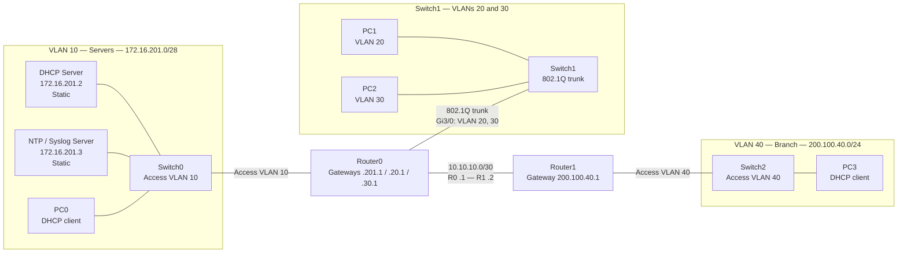

# VLAN DHCP, NTP and Syslog Monitoring Lab

## Lab objective

Configure the Packet Tracer network to provide:

- Four VLANs: server VLAN 10, user VLANs 20 and 30, and branch VLAN 40.
- Centralized DHCP from `172.16.201.2`, including DHCP relay on VLANs 20, 30, and 40.
- Static IP addresses for the DHCP and NTP/syslog servers.
- NTP synchronization for routers and switches from `172.16.201.3`.
- Router and switch log delivery to the syslog service at `172.16.201.3`.
- Static routing between Router0 and Router1.

> [!important] Addressing scope
> This guide preserves the addresses supplied for the lab. The `200.100.x.x` networks are public address space, not private RFC 1918 ranges. Use them only in this isolated exercise unless the ranges have been assigned to you.

---

## Starting files

- Packet Tracer project: [[DHCP NTP Syslog.pkt]]
- Original topology image: ![[Images/network-topology.png]]

## 1. Topology



### Physical cabling plan

Use the corresponding live interface shown in Packet Tracer. Interface availability can differ with router modules; check `show ip interface brief` before pasting interface commands.

| Link | Suggested interface/cable role |
|---|---|
| DHCP server, NTP/syslog server, PC0 ↔ Switch0 | Server/PC access ports in VLAN 10 |
| Switch0 Gi0/1 ↔ Router0 Gi2/0 | Access VLAN 10 on switch; routed gateway interface on R0 |
| PC1 ↔ Switch1 Fa0/1 | Access VLAN 20 |
| PC2 ↔ Switch1 Fa0/11 | Access VLAN 30 |
| Switch1 Gi0/1 ↔ Router0 Gi3/0 | 802.1Q trunk, VLANs 20 and 30 |
| Router0 Gi0/0 ↔ Router1 Gi0/0 | Routed point-to-point link, `10.10.10.0/30` |
| Router1 Gi2/0 ↔ Switch2 Gi0/1 | Access VLAN 40 on switch; routed gateway interface on R1 |
| PC3 ↔ Switch2 Fa0/1 | Access VLAN 40 |

> [!note] Why Router0 uses subinterfaces
> The supplied image puts VLAN 20 and VLAN 30 PCs on one switch with one uplink to Router0. That uplink must be an 802.1Q trunk, with one router subinterface per VLAN. This configuration follows the image and the supplied requirement that Switch1 Gi0/1 carries VLANs 20 and 30.

---

## 2. Addressing plan

| Network | Network / mask | Gateway | Reserved/static addresses | DHCP clients |
|---|---|---|---|---|
| VLAN 10 — servers | `172.16.201.0/28` · `255.255.255.240` | `172.16.201.1` | DHCP `.2`; NTP/syslog `.3`; Switch0 mgmt `.14` | `.4`–`.13` |
| VLAN 20 — users | `200.100.20.0/24` · `255.255.255.0` | `200.100.20.1` | Switch1 mgmt `.2` | `.21`–`.254` |
| VLAN 30 — users | `200.100.30.0/24` · `255.255.255.0` | `200.100.30.1` | No additional address reserved here | `.21`–`.254` |
| VLAN 40 — branch | `200.100.40.0/24` · `255.255.255.0` | `200.100.40.1` | Switch2 mgmt `.2` | `.21`–`.254` |
| R0–R1 | `10.10.10.0/30` · `255.255.255.252` | N/A | R0 `10.10.10.1`; R1 `10.10.10.2` | None |

VLAN 10 has network address `172.16.201.0`, usable range `.1`–`.14`, and broadcast `.15`. VLANs 20, 30, and 40 each have broadcast address `.255`.

> [!warning] Keep static and dynamic addresses separate
> The DHCP pool for VLAN 10 is limited to `.4`–`.13`; `.14` is reserved for Switch0 management. The other DHCP pools begin at `.21`, leaving `.2` available for switch management and `.1` for the gateway.

---

## 3. Configure the switches

Check the actual connected ports first and adjust the interface IDs if your Packet Tracer cabling differs.

### Switch0 — server access VLAN

```cisco
enable
configure terminal
hostname Switch0
vlan 10
 name SERVER_NETWORK
exit
interface range fastEthernet0/1 - 5
 switchport mode access
 switchport access vlan 10
 spanning-tree portfast
 no shutdown
exit
interface gigabitEthernet0/1
 description UPLINK_TO_ROUTER0_VLAN10
 switchport mode access
 switchport access vlan 10
 no shutdown
end
write memory
```

### Switch1 — user VLANs 20 and 30

```cisco
enable
configure terminal
hostname Switch1
vlan 20
 name USER_VLAN_20
vlan 30
 name USER_VLAN_30
exit
interface range fastEthernet0/1-10
 description PC1_VLAN20
 switchport mode access
 switchport access vlan 20
 spanning-tree portfast
 no shutdown
exit
interface range fastEthernet0/11-20
 description PC2_VLAN30
 switchport mode access
 switchport access vlan 30
 spanning-tree portfast
 no shutdown
exit
interface gigabitEthernet0/1
 description DOT1Q_TRUNK_TO_ROUTER0
 switchport mode trunk
 switchport trunk allowed vlan 20,30
 no shutdown
end
write memory
```

### Switch2 — branch VLAN 40

```cisco
enable
configure terminal
hostname Switch2
vlan 40
 name BRANCH_NETWORK
exit
interface range fastEthernet0/1-10
 description PC3_VLAN40
 switchport mode access
 switchport access vlan 40
 spanning-tree portfast
 no shutdown
exit
interface gigabitEthernet0/1
 description UPLINK_TO_ROUTER1_VLAN40
 switchport mode access
 switchport access vlan 40
 no shutdown
end
write memory
```

---

## 4. Configure Router0

Router0 serves VLAN 10 on a routed interface, VLANs 20 and 30 on subinterfaces of the Switch1 trunk, and the point-to-point link to Router1.

```cisco
enable
configure terminal
hostname Router0
no ip domain-lookup
service timestamps log datetime msec
!
interface gigabitEthernet2/0
 description VLAN10_SERVER_LAN
 ip address 172.16.201.1 255.255.255.240
 no shutdown
!
interface gigabitEthernet3/0
 description DOT1Q_TRUNK_TO_SWITCH1
 no ip address
 no shutdown
!
interface gigabitEthernet3/0.20
 encapsulation dot1Q 20
 description VLAN20_USER_LAN
 ip address 200.100.20.1 255.255.255.0
 ip helper-address 172.16.201.2
!
interface gigabitEthernet3/0.30
 encapsulation dot1Q 30
 description VLAN30_USER_LAN
 ip address 200.100.30.1 255.255.255.0
 ip helper-address 172.16.201.2
!
interface gigabitEthernet0/0
 description POINT_TO_POINT_TO_ROUTER1
 ip address 10.10.10.1 255.255.255.252
 no shutdown
!
ip route 200.100.40.0 255.255.255.0 10.10.10.2
!
ntp server 172.16.201.3
logging host 172.16.201.3
logging trap informational
end
write memory
```

## 5. Configure Router1

```cisco
enable
configure terminal
hostname Router1
no ip domain-lookup
service timestamps log datetime msec
!
interface gigabitEthernet0/0
 description POINT_TO_POINT_TO_ROUTER0
 ip address 10.10.10.2 255.255.255.252
 no shutdown
!
interface gigabitEthernet2/0
 description VLAN40_BRANCH_LAN
 ip address 200.100.40.1 255.255.255.0
 ip helper-address 172.16.201.2
 no shutdown
!
ip route 172.16.201.0 255.255.255.240 10.10.10.1
ip route 200.100.20.0 255.255.255.0 10.10.10.1
ip route 200.100.30.0 255.255.255.0 10.10.10.1
!
ntp server 172.16.201.3
logging host 172.16.201.3
logging trap informational
end
write memory
```

The helper address is configured on both R0 VLAN subinterfaces and R1's VLAN 40 interface, as required. Router0's directly connected server subnet lets it reach the DHCP and NTP/syslog servers. Router1's static routes reach those servers and the user VLANs through Router0.

---

## 6. Configure the servers

### DHCP Server — static IP and DHCP service

In Packet Tracer, open **DHCP Server → Desktop → IP Configuration**:

| Setting | Value |
|---|---|
| IP address | `172.16.201.2` |
| Subnet mask | `255.255.255.240` |
| Default gateway | `172.16.201.1` |

Then open **Services → DHCP**, set the service to **On**, and add these pools:

| Pool name | Default gateway | Start IP | Subnet mask | Maximum users |
|---|---|---|---|---:|
| VLAN10 | `172.16.201.1` | `172.16.201.4` | `255.255.255.240` | 10 |
| VLAN20 | `200.100.20.1` | `200.100.20.21` | `255.255.255.0` | 234 |
| VLAN30 | `200.100.30.1` | `200.100.30.21` | `255.255.255.0` | 234 |
| VLAN40 | `200.100.40.1` | `200.100.40.21` | `255.255.255.0` | 234 |

The VLAN 10 pool stops at `.13`, so it cannot lease Switch0's management IP `.14`. Configure PC0, PC1, PC2, and PC3 in **Desktop → IP Configuration → DHCP**.

### NTP/Syslog Server — static IP and services

Open **NTP/Syslog Server → Desktop → IP Configuration**:

| Setting | Value |
|---|---|
| IP address | `172.16.201.3` |
| Subnet mask | `255.255.255.240` |
| Default gateway | `172.16.201.1` |

Under **Services**, switch **NTP** and **SYSLOG** to **On**. The server's syslog event list should receive messages from both routers and the switches after the devices can reach it and new events are generated.

---

## 7. Configure switch management, NTP and syslog

Each switch has a management SVI in a VLAN it already carries. The chosen management IPs are excluded from the DHCP pools.

### Switch0

```cisco
configure terminal
interface vlan 10
 ip address 172.16.201.14 255.255.255.240
 no shutdown
exit
ip default-gateway 172.16.201.1
ntp server 172.16.201.3
logging host 172.16.201.3
logging trap informational
end
write memory
```

### Switch1

```cisco
configure terminal
interface vlan 20
 ip address 200.100.20.2 255.255.255.0
 no shutdown
exit
ip default-gateway 200.100.20.1
ntp server 172.16.201.3
logging host 172.16.201.3
logging trap informational
end
write memory
```

Switch1's VLAN 20 SVI can reach Router0 over the trunk. Router0 then routes it to the VLAN 10 servers. VLAN 20 is already permitted on the trunk.

### Switch2

```cisco
configure terminal
interface vlan 40
 ip address 200.100.40.2 255.255.255.0
 no shutdown
exit
ip default-gateway 200.100.40.1
ntp server 172.16.201.3
logging host 172.16.201.3
logging trap informational
end
write memory
```

---

## 8. Verify the configuration

### Routers

```cisco
show ip interface brief
show ip route
show running-config | include helper-address|ntp server|logging host|ip route
show ntp status
show logging
```

Check that used interfaces are up/up, helper addresses are on the correct interfaces, R0 has a route to VLAN 40, and R1 has routes to VLANs 10, 20, and 30. NTP synchronization can take time; Packet Tracer may model NTP behavior differently from physical IOS devices.

### Switches

```cisco
show vlan brief
show interfaces trunk
show ip interface brief
show ntp status
show logging
```

Switch1's trunk should allow VLANs 20 and 30. Confirm PC-facing access ports are in the correct VLAN and each management SVI is up.

### End-to-end checklist

1. PC0–PC3 receive addresses from the correct subnet, with the correct mask and gateway.
2. PC1 and PC2 can ping `172.16.201.2` and `172.16.201.3` after receiving DHCP leases.
3. PC3 can ping its gateway and the two servers through Router1 and Router0.
4. Router0 and Router1 can reach `172.16.201.3` and show the configured NTP peer.
5. Switch0, Switch1, and Switch2 can reach the NTP/syslog server from their management IPs.
6. Generate a fresh interface or configuration event on each router; confirm both routers appear in the syslog server's event list.

## Troubleshooting

| Symptom | Check |
|---|---|
| PC in VLAN 20 or 30 gets no lease | Switch access VLAN, trunk allowed VLAN list, matching R0 subinterface/tag, helper address, DHCP pool gateway/mask, and server reachability. |
| PC3 gets no lease | R1 VLAN 40 interface/helper, DHCP pool, R0–R1 link, and R1 route to `172.16.201.0/28`. |
| Wrong address or gateway | The PC's access VLAN and the matching DHCP pool's network, start address, mask, and default gateway. |
| Switch1 cannot reach servers | VLAN 20 trunk allowance, Switch1 `interface vlan 20`, default gateway `200.100.20.1`, and R0 server interface. |
| Router1 cannot reach server | R1 static route to VLAN 10, R0–R1 link state/addressing, and server default gateway. |
| No NTP synchronization | NTP service enabled, correct server address, routing, and enough time for synchronization. |
| No syslog messages | SYSLOG service enabled, `logging host` configured, server reachable, and a new event generated. |
| Subinterface or trunk command rejected | Confirm the router has a supported Ethernet interface/module and the interface name matches the installed Packet Tracer hardware. |

## Related labs

- [[Three-Router Static Routing Lab]]
- [[Multilayer-Switch-Redundancy-DHCP-EtherChannel]]
